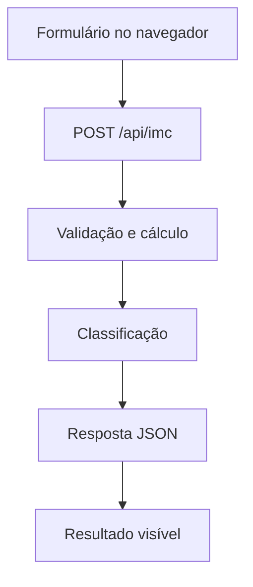
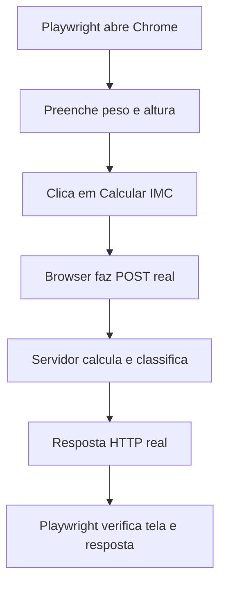

# Tutorial completo: do IMC aos testes, Docker e CI/CD

**Disciplina:** Métodos e Ferramentas de Desenvolvimento de Software. **Projeto:** IMC Web. **Estrutura:** Parte I (programa e testes) e Parte II (contêineres, GitHub Actions, proteção de branch, Pull Request guiado e publicação). **Não há trabalho em dupla de contas**: cada equipe mantém um repositório próprio, operado por uma conta autorizada da equipe. **Não há duração prescrita**.

> Objetivo verificável: construir um sistema que calcula e classifica IMC, executar 4 modalidades de testes, criar uma imagem Docker, demonstrar CI bloqueando um Pull Request defeituoso, corrigir o defeito e publicar a alteração após aprovação dos testes.

**Princípio didático:** primeiro ensinamos o comportamento que deve ser validado, depois os mecanismos de execução, e finalmente a automação. Cada ferramenta entra porque há um problema concreto a resolver.

**Nota de privacidade do laboratório:** antes de criar contas ou repositórios públicos, confirme com a instituição a autorização e os requisitos etários dos serviços. Não publique nome completo de menor, e-mail pessoal, matrícula, fotos, tokens ou informações da turma. Sempre que possível, utilize identificadores neutros para as equipes.

**Limites do exemplo:** IMC é usado como regra matemática introdutória. As categorias apresentadas são didáticas para adultos, não representam avaliação de saúde individual e não se aplicam universalmente a estudantes adolescentes. O projeto não armazena dados pessoais.

## Índice

**Parte I:** 0. Preparar a máquina; 1. Criar o projeto; 2. Implementar as regras de negócio; 3. Criar API e interface; 4. Executar o sistema; 5. Testes unitários; 6. Testes de integração; 7. Teste funcional com Playwright; 8. Teste ponta a ponta; 9. Evidências da primeira parte.

**Parte II:** 10. Docker no Windows e permissões do laboratório; 11. Dockerfile e imagem; 12. Execução, diagnóstico e testes no contêiner; 13. Git e GitHub no Windows: conferir conta, credenciais e repositório da equipe; 14. Pipeline CI; 15. Proteger main; 16. Vercel com publicação controlada; 17. Workflow de entrega contínua (CD); 18. Incidente guiado: Pull Request, teste vermelho, correção e publicação; 19. Solução de problemas; 20. Checklist do aluno e do professor.

---

# PARTE I — Construir e testar antes de automatizar

## 0. Preparação inicial: o que existe e o que precisa instalar

**Aplicativos já presentes no laboratório:** Chrome, Node.js e React. **React não é necessário neste projeto**, porque o objetivo é aprender as etapas de engenharia sem um framework de interface adicional. O Chrome já instalado serve para a navegação manual; para testes Playwright, normalmente precisamos também dos binários de navegador gerenciados pelo Playwright. **Node.js recomendado:** versões atuais compatíveis com o Playwright, por exemplo Node 22, 24 ou 26; se o laboratório possuir uma versão mais antiga, solicitar atualização ao técnico.

**Ferramentas que precisam estar disponíveis:** Prompt de Comando (cmd), editor de texto (VS Code, se presente; caso contrário outro editor), Node.js com npm, Git para Windows (preferencialmente com Git Credential Manager), Chrome; acesso à internet para baixar dependências npm e Playwright; conta GitHub da equipe; conta Vercel da equipe (apenas na Parte II). Docker deve ser previamente disponibilizado pelo técnico com permissão adequada. Não é necessário instalar Java, JUnit, Maven, React adicional, banco de dados nem uma extensão de teste do Chrome.

**Verificações no Windows:** clique no **Iniciar**, digite `cmd` e abra **Prompt de Comando**. Todos os comandos de terminal deste tutorial são apresentados para **Windows (cmd)**; no VS Code, selecione **Terminal → Novo Terminal**, clique na seta ao lado do botão `+`, selecione **Selecionar Perfil Padrão → Prompt de Comando**, feche o terminal anterior e abra outro. Digite cada comando abaixo e pressione Enter após cada linha:

```bat
node --version
npm --version
git --version
```

**Esperado:** cada comando exibe um número de versão. Se `git` não for reconhecido, peça ao técnico a instalação ou use o Git já disponível no laboratório. Se `npm` estiver bloqueado por uma política do PowerShell, **não modifique a política de execução global do laboratório**; solicite ajuda ao técnico ou execute os comandos no terminal Prompt de Comando (cmd). Se a rede bloquear downloads do npm, o técnico deverá providenciar acesso permitido, cache ou uma cópia das dependências; Chrome instalado não substitui automaticamente os binários do Playwright.

**Local do trabalho no Windows:** abra o **Explorador de Arquivos** com **Win+E** → **Documentos** → botão direito em área vazia → **Novo → Pasta** → nomeie `imc-web`. Se a pasta Documentos for redirecionada para OneDrive ou estiver protegida, solicite ao técnico uma pasta individual com permissão de escrita. No VS Code, clique **Arquivo → Abrir Pasta**, selecione `imc-web` e clique **Selecionar Pasta**. Use **Terminal → Novo Terminal** e confira que o caminho termina em `imc-web`. Para conferir a pasta atual no cmd, digite `cd`. Para acessar a pasta pelo cmd sem presumir seu caminho, no Explorador abra `imc-web`, clique na barra de endereços, copie o caminho completo, e no cmd execute `cd /d "COLE_AQUI_O_CAMINHO_COMPLETO"`, substituindo o texto dentro das aspas pelo caminho copiado. **Todos os comandos seguintes presumem o terminal dentro de `imc-web`, salvo aviso contrário.**

## 1. Criar os arquivos iniciais

No VS Code, na barra lateral esquerda, clique no primeiro ícone **Explorer**. Na pasta `imc-web`, use o ícone **New File** para criar `package.json`, e **New Folder** para criar `public`, `src`, `api` e `tests`. Dentro de `tests`, crie as pastas `unit`, `integration`, `functional` e `e2e`. Mais tarde criaremos `.github/workflows`. Se o editor não estiver disponível, crie as mesmas pastas com o gerenciador de arquivos e salve os arquivos em um editor simples, prestando atenção nas extensões exatas.

Atenção: pastas com ponto inicial, como `.github`, não são extensões de arquivo; são nomes de diretórios. No Windows, certifique-se de que o Explorer não adicionou `.txt` a arquivos como `Dockerfile` ou `.gitignore`.

**Por que `package.json`?** É o manifesto do projeto Node.js. Declara seu nome, os comandos que podemos executar (`npm start`, `npm run ...`) e as dependências. O npm gerará `package-lock.json` quando instalarmos as dependências; o arquivo lock registra versões resolvidas para instalações reproduzíveis.

**Onde criar:** raiz do projeto → caminho `package.json`. Cole integralmente o conteúdo abaixo e salve com **Ctrl+S**.

**Arquivo `package.json` — copie TODO o bloco para dentro deste arquivo (sem incluir as crases da cerca).**

```json
{
  "name": "imc-web-tutorial",
  "version": "1.0.0",
  "private": true,
  "type": "module",
  "scripts": {
    "start": "node src/server.js",
    "test:unit": "node --test tests/unit/*.test.js",
    "test:integration": "node --test tests/integration/*.test.js",
    "test:functional": "playwright test tests/functional",
    "test:e2e": "playwright test tests/e2e",
    "test:all": "npm run test:unit && npm run test:integration && npm run test:functional && npm run test:e2e"
  },
  "devDependencies": {
    "@playwright/test": "^1.57.0"
  }
}
```

Depois, no terminal aberto na raiz `imc-web`, execute:

```bat
npm install
```

**Esperado:** a pasta `node_modules` e o arquivo `package-lock.json` aparecem. Não copie `node_modules` para o GitHub; ele será ignorado. **É obrigatório manter `package-lock.json` no repositório**, porque Docker e GitHub Actions utilizarão `npm ci`, que exige esse arquivo. Se aparecer erro de rede ou permissão, não continue até que o técnico resolva o acesso a dependências.

## 2. Requisitos e regras de negócio

**Requisito funcional 1:** ao receber peso (kg) e altura (m), o sistema devolve IMC = peso/(altura×altura). **Requisito funcional 2:** classifica o resultado para adultos: abaixo de 18,5: Baixo peso; de 18,5 até antes de 25: Peso adequado; de 25 até antes de 30: Sobrepeso; 30 ou mais: Obesidade. **Requisito de validação:** entradas devem ser números finitos e positivos. Essas regras são especificações testáveis.

**Regra de organização:** `src/imc.js` não pode depender de navegador nem de servidor. Assim poderá ser testado sozinho.

**Onde criar:** raiz do projeto → caminho `src/imc.js`. No Explorer, clique com o botão direito em `src`, selecione **New File**, digite `imc.js` e cole o código.

**Arquivo `src/imc.js` — copie TODO o bloco para dentro deste arquivo (sem incluir as crases da cerca).**

```javascript
// Regras de negócio: independentes do HTML, do servidor e do banco de dados.
export function calcularIMC(peso, altura) {
  if (typeof peso !== 'number' || typeof altura !== 'number' ||
      !Number.isFinite(peso) || !Number.isFinite(altura) ||
      peso <= 0 || altura <= 0) {
    throw new RangeError('Peso e altura devem ser números positivos');
  }
  return peso / (altura * altura);
}

export function classificarIMC(imc) {
  if (typeof imc !== 'number' || !Number.isFinite(imc) || imc <= 0) {
    throw new RangeError('IMC inválido');
  }
  if (imc < 18.5) return 'Baixo peso';
  if (imc < 25) return 'Peso adequado';
  if (imc < 30) return 'Sobrepeso';
  return 'Obesidade';
}
```

**Entenda o código:** `export` permite importar funções de outro arquivo. `Number.isFinite` rejeita valores não finitos. `throw new RangeError` interrompe o processamento de uma entrada inválida. O bloco `if (imc < 25)` **está correto**: em IMC igual a 25, a condição é falsa e o código prossegue para `Sobrepeso`. O defeito proposital da atividade de incidente será trocar `<` por `<=`, o que classificaria **erradamente** IMC 25 como `Peso adequado`.

## 3. Camadas do servidor, API e interface

Para distinguir os conceitos, usaremos uma API HTTP. O navegador enviará `{peso,altura}` via `fetch` para `/api/imc`, e receberá JSON com `{imc,situacao}`. Isso cria um limite de integração observável.



Primeiro crie o serviço compartilhado. Ele será utilizado tanto no servidor Node.js local quanto na função serverless da Vercel. Dessa maneira evitamos dois cálculos divergentes.

**Onde criar:** raiz do projeto → caminho `src/handle-imc.js`. Em `src`, clique em **New File** e crie `handle-imc.js`.

**Arquivo `src/handle-imc.js` — copie TODO o bloco para dentro deste arquivo (sem incluir as crases da cerca).**

```javascript
import { calcularIMC, classificarIMC } from './imc.js';

// Serviço compartilhado pelo servidor local e pela função da Vercel.
export function processarIMC(dados) {
  try {
    const imc = calcularIMC(dados?.peso, dados?.altura);
    // Convenção didática: classificar o mesmo IMC exibido (duas casas decimais).
    const imcExibido = Number(imc.toFixed(2));
    return { status: 200, corpo: { imc: imcExibido, situacao: classificarIMC(imcExibido) } };
  } catch (erro) {
    if (erro instanceof RangeError) {
      return { status: 400, corpo: { erro: erro.message } };
    }
    throw erro;
  }
}
```

Agora crie o servidor Node. Ele deverá servir quatro arquivos estáticos e atender ao endpoint `/api/imc`. Usaremos apenas o módulo HTTP nativo, sem Express, para reduzir a quantidade de ferramentas novas. **O servidor será iniciado com `npm start`**.

**Onde criar:** raiz do projeto → caminho `src/server.js`. Em `src`, crie `server.js` e cole o bloco completo.

**Arquivo `src/server.js` — copie TODO o bloco para dentro deste arquivo (sem incluir as crases da cerca).**

```javascript
import { createServer } from 'node:http';
import { readFile } from 'node:fs/promises';
import { fileURLToPath } from 'node:url';
import { dirname, join, resolve } from 'node:path';
import { processarIMC } from './handle-imc.js';

const aqui = dirname(fileURLToPath(import.meta.url));
const publicDir = join(aqui, '..', 'public');
const arquivos = new Map([
  ['/', ['index.html', 'text/html; charset=utf-8']],
  ['/index.html', ['index.html', 'text/html; charset=utf-8']],
  ['/style.css', ['style.css', 'text/css; charset=utf-8']],
  ['/app.js', ['app.js', 'text/javascript; charset=utf-8']]
]);

function json(res, codigo, dados) {
  res.writeHead(codigo, { 'Content-Type': 'application/json; charset=utf-8' });
  res.end(JSON.stringify(dados));
}

export function criarServidor() {
  return createServer(async (req, res) => {
    const caminho = new URL(req.url, 'http://localhost').pathname;

    if (caminho === '/api/imc') {
      if (req.method !== 'POST') {
        res.setHeader('Allow', 'POST');
        return json(res, 405, { erro: 'Método não permitido' });
      }
      try {
        let texto = '';
        for await (const parte of req) {
          texto += parte.toString();
          if (texto.length > 10000) return json(res, 413, { erro: 'Corpo muito grande' });
        }
        const dados = JSON.parse(texto);
        const resultado = processarIMC(dados);
        return json(res, resultado.status, resultado.corpo);
      } catch (erro) {
        if (erro instanceof SyntaxError) {
          return json(res, 400, { erro: 'JSON inválido' });
        }
        return json(res, 500, { erro: 'Erro interno' });
      }
    }

    if (req.method !== 'GET') return json(res, 405, { erro: 'Método não permitido' });
    const arquivo = arquivos.get(caminho);
    if (!arquivo) return json(res, 404, { erro: 'Página não encontrada' });
    try {
      const conteudo = await readFile(join(publicDir, arquivo[0]));
      res.writeHead(200, { 'Content-Type': arquivo[1] });
      res.end(conteudo);
    } catch {
      json(res, 500, { erro: 'Não foi possível ler arquivo' });
    }
  });
}

// Só inicia porta ao executar este arquivo diretamente, não ao importá-lo em testes.
if (process.argv[1] && fileURLToPath(import.meta.url) === resolve(process.argv[1])) {
  const porta = Number(process.env.PORT ?? 3000);
  criarServidor().listen(porta, '0.0.0.0', () => {
    console.log(`IMC Web em http://localhost:${porta}`);
  });
}
```

**Leitura do servidor:** `createServer` recebe cada solicitação HTTP. Se o caminho for `/api/imc`, ele exige `POST`, lê JSON, chama `processarIMC` e devolve o resultado. Para `/`, `/style.css` e `/app.js`, devolve arquivos estáticos. `criarServidor()` foi exportado para que testes de integração possam inicializar um servidor temporário, sem disputar a porta 3000.

Agora crie a interface. Nela, os identificadores `peso`, `altura`, `form-imc` e `resultado` também serão usados pelo Playwright. **Não os renomeie**, pois os testes precisam encontrar esses elementos.

**Onde criar:** raiz do projeto → caminho `public/index.html`. Clique em `public` → **New File** → `index.html`.

**Arquivo `public/index.html` — copie TODO o bloco para dentro deste arquivo (sem incluir as crases da cerca).**

```html
<!doctype html>
<html lang="pt-BR">
<head>
  <meta charset="utf-8">
  <meta name="viewport" content="width=device-width, initial-scale=1">
  <title>IMC Web — Testes e DevOps</title>
  <link rel="stylesheet" href="/style.css">
  <script src="/app.js" defer></script>
</head>
<body>
  <main class="cartao">
    <h1>Calculadora de IMC</h1>
    <p>Informe o peso em quilogramas e a altura em metros.</p>
    <form id="form-imc">
      <label for="peso">Peso (kg)</label>
      <input id="peso" name="peso" type="number" step="any" min="0.01" required placeholder="Ex.: 80">
      <label for="altura">Altura (m)</label>
      <input id="altura" name="altura" type="number" step="any" min="0.01" required placeholder="Ex.: 2">
      <button type="submit">Calcular IMC</button>
    </form>
    <section id="resultado" role="status" aria-live="polite"></section>
    <small>Classificação didática para adultos; não substitui avaliação clínica.</small>
  </main>
</body>
</html>
```

**Onde criar:** raiz do projeto → caminho `public/style.css`. Na mesma pasta, crie `style.css`.

**Arquivo `public/style.css` — copie TODO o bloco para dentro deste arquivo (sem incluir as crases da cerca).**

```css
* { box-sizing: border-box; }
body { margin: 0; min-height: 100vh; display: grid; place-items: center; background: #edf2f8; color: #192638; font: 16px/1.5 system-ui, sans-serif; }
.cartao { background: white; border-radius: 16px; max-width: 430px; width: calc(100% - 32px); padding: 28px; box-shadow: 0 14px 45px #19304b20; }
h1 { margin-top: 0; }
form { display: grid; gap: 9px; }
label { font-weight: 650; }
input { width: 100%; padding: 12px; border: 1px solid #a1acb8; border-radius: 8px; font: inherit; margin-bottom: 10px; }
button { background: #1457bf; color: white; border: none; border-radius: 8px; font: inherit; font-weight: 700; padding: 12px; cursor: pointer; }
button:hover { background: #0b3d90; }
#resultado { min-height: 68px; padding: 12px 0; font-weight: 700; }
#resultado.erro { color: #a32121; }
small { display: block; color: #4e5966; }
```

**Onde criar:** raiz do projeto → caminho `public/app.js`. Na mesma pasta, crie `app.js`.

**Arquivo `public/app.js` — copie TODO o bloco para dentro deste arquivo (sem incluir as crases da cerca).**

```javascript
const formulario = document.querySelector('#form-imc');
const resultado = document.querySelector('#resultado');

formulario.addEventListener('submit', async (evento) => {
  evento.preventDefault(); // Não recarrega a página.
  resultado.classList.remove('erro');
  resultado.textContent = 'Calculando...';

  const peso = Number(document.querySelector('#peso').value);
  const altura = Number(document.querySelector('#altura').value);

  try {
    const resposta = await fetch('/api/imc', {
      method: 'POST',
      headers: { 'Content-Type': 'application/json' },
      body: JSON.stringify({ peso, altura })
    });

    const dados = await resposta.json();
    if (!resposta.ok) throw new Error(dados.erro ?? 'Falha na API');

    resultado.textContent = `IMC: ${dados.imc.toFixed(2)} — ${dados.situacao}`;
  } catch (erro) {
    resultado.classList.add('erro');
    resultado.textContent = `Erro: ${erro.message}`;
  }
});
```

**Convenção de arredondamento (importante):** a API arredonda o IMC a **duas casas decimais antes de classificá-lo**; a interface também apresenta duas casas. Portanto, peso `99,99` kg e altura `2` m produzem IMC bruto `24,9975`, exibido como `25.00` e classificado como `Sobrepeso`. Isso evita mostrar uma categoria incompatível com o índice visível. É uma convenção didática explícita, não uma regra clínica universal. Digite os números com ponto decimal nos testes automatizados; no formulário do navegador, respeite a configuração regional de entrada numérica.

**Como a interface trabalha:** `event.preventDefault()` impede que a página recarregue ao enviar o formulário. `fetch('/api/imc', ...)` faz uma requisição HTTP ao servidor. `await resposta.json()` lê o corpo da resposta. O campo `#resultado` é atualizado com `textContent`, sem inserir HTML arbitrário. Em caso de falha, o bloco `catch` apresenta uma mensagem de erro.

Finalmente, prepare a função da Vercel. Ela não participa da execução local, mas será necessária no momento da publicação da API.

**Onde criar:** raiz do projeto → caminho `api/imc.js`. Dentro de `api`, crie `imc.js`. **Não confundir** com `src/imc.js`: um é o endpoint da plataforma; o outro contém as regras matemáticas.

**Arquivo `api/imc.js` — copie TODO o bloco para dentro deste arquivo (sem incluir as crases da cerca).**

```javascript
import { processarIMC } from '../src/handle-imc.js';

// Vercel Function: mesma lógica do servidor local.
export default function handler(req, res) {
  if (req.method !== 'POST') {
    res.setHeader('Allow', 'POST');
    return res.status(405).json({ erro: 'Método não permitido' });
  }
  const resultado = processarIMC(req.body);
  return res.status(resultado.status).json(resultado.corpo);
}
```

## 4. Executar manualmente a aplicação

No VS Code, selecione **Terminal → New Terminal**, confirme que o terminal está na pasta `imc-web` e execute:

```bat
npm start
```

**Esperado no terminal:** `IMC Web em http://localhost:3000`. Abra o Chrome, clique na barra de endereços, digite `http://localhost:3000` e pressione Enter. Informe **peso 80** e **altura 2**, clique **Calcular IMC**. O texto de resultado deverá mostrar exatamente `IMC: 20.00 — Peso adequado`. Informe **peso 120**, **altura 2**; o resultado deverá ser `IMC: 30.00 — Obesidade`.

Para encerrar o servidor, volte ao terminal e pressione **Ctrl+C**. O servidor precisa estar desligado ou em outra porta quando você desejar executar certas operações manualmente. Nos testes de navegador, o próprio Playwright poderá iniciá-lo.

**Se o endereço não abrir:** confirme o terminal, verifique se a porta 3000 já está ocupada e não confunda `localhost:3000` com `localhost:5173` de projetos React/Vite. Para este tutorial, use a porta 3000.

## 5. Testes unitários: verificar uma regra isolada

Um teste unitário testa uma unidade pequena sem depender da interface, do HTTP ou do banco de dados. Usaremos o test runner nativo do Node (`node:test`) e asserções de `node:assert/strict`.

**Estrutura:** preparar a entrada → executar a função → comparar o resultado esperado com o observado. Os casos de fronteira são especialmente importantes: 18,49 versus 18,50; 24,99 versus 25; 29,99 versus 30.

**Onde criar:** raiz do projeto → caminho `tests/unit/imc.test.js`. No Explorer, expanda `tests` → `unit`, crie `imc.test.js`.

**Arquivo `tests/unit/imc.test.js` — copie TODO o bloco para dentro deste arquivo (sem incluir as crases da cerca).**

```javascript
import test from 'node:test';
import assert from 'node:assert/strict';
import { calcularIMC, classificarIMC } from '../../src/imc.js';

test('IMC de 80 kg e 2 m é 20', () => {
  assert.equal(calcularIMC(80, 2), 20);
});

test('IMC rejeita altura zero', () => {
  assert.throws(() => calcularIMC(80, 0), RangeError);
});

test('IMC rejeita peso não numérico', () => {
  assert.throws(() => calcularIMC('80', 2), RangeError);
});

for (const [valor, esperado] of [
  [18.49, 'Baixo peso'],
  [18.5, 'Peso adequado'],
  [24.99, 'Peso adequado'],
  [25, 'Sobrepeso'],
  [29.99, 'Sobrepeso'],
  [30, 'Obesidade']
]) {
  test(`classificação no limite ${valor}`, () => {
    assert.equal(classificarIMC(valor), esperado);
  });
}
```

Execute **na raiz do projeto**:

```bat
npm run test:unit
```

**Esperado:** todos os testes unitários apresentam `ok` e a execução termina sem falhas. Quando aparece `not ok`, leia as linhas `expected` (esperado) e `actual` (recebido). Não altere o teste para aceitar um erro do software; verifique se a especificação está correta e então corrija a implementação.

**Exercício de leitura:** localize o teste `classificação no limite 25`. Ele não verifica a aparência da tela: verifica exclusivamente a regra de classificação. Essa distinção explica por que os testes unitários são rápidos.

## 6. Testes de integração: verificar componentes colaborando

Agora o objetivo será exercitar uma requisição real: HTTP → parsing JSON → serviço → funções de cálculo e classificação → resposta HTTP. A unidade testada não é mais uma função isolada: é a **integração entre vários componentes**.

O teste iniciará uma instância temporária do servidor em porta livre (`listen(0)`), enviará solicitações com `fetch` e encerrará o servidor. Assim não será necessário manter `npm start` aberto para os testes de integração.

**Onde criar:** raiz do projeto → caminho `tests/integration/api.test.js`. No Explorer, expanda `tests` → `integration`, crie `api.test.js`.

**Arquivo `tests/integration/api.test.js` — copie TODO o bloco para dentro deste arquivo (sem incluir as crases da cerca).**

```javascript
import test from 'node:test';
import assert from 'node:assert/strict';
import { once } from 'node:events';
import { criarServidor } from '../../src/server.js';

// Cada teste de integração sobe uma API HTTP real numa porta livre.
async function comServidor(executar) {
  const servidor = criarServidor();
  servidor.listen(0, '127.0.0.1');
  await once(servidor, 'listening');
  const { port } = servidor.address();
  try {
    await executar(`http://127.0.0.1:${port}`);
  } finally {
    await new Promise((resolve, reject) => {
      servidor.close(erro => erro ? reject(erro) : resolve());
    });
  }
}

test('API integra HTTP, cálculo e classificação', async () => {
  await comServidor(async base => {
    const resposta = await fetch(`${base}/api/imc`, {
      method: 'POST',
      headers: { 'Content-Type': 'application/json' },
      body: JSON.stringify({ peso: 80, altura: 2 })
    });
    assert.equal(resposta.status, 200);
    assert.deepEqual(await resposta.json(), {
      imc: 20,
      situacao: 'Peso adequado'
    });
  });
});

test('API retorna HTTP 400 para altura zero', async () => {
  await comServidor(async base => {
    const resposta = await fetch(`${base}/api/imc`, {
      method: 'POST',
      headers: { 'Content-Type': 'application/json' },
      body: JSON.stringify({ peso: 80, altura: 0 })
    });
    assert.equal(resposta.status, 400);
    assert.match((await resposta.json()).erro, /positivos/);
  });
});

test('API rejeita método GET na rota de cálculo', async () => {
  await comServidor(async base => {
    const resposta = await fetch(`${base}/api/imc`);
    assert.equal(resposta.status, 405);
  });
});
```

Execute:

```bat
npm run test:integration
```

**Esperado:** três verificações aprovadas: cálculo e classificação pelo HTTP; HTTP 400 para altura inválida; HTTP 405 para o método GET. Entenda que um `status 200` significa operação aceita, `400` significa requisição inválida, e `405` indica método HTTP não permitido.

**Diferença:** um teste unitário poderia passar mesmo que o endpoint retornasse um JSON com nomes de propriedades errados; o teste de integração detectaria esse defeito.

## 7. Teste funcional de interface com Playwright e API simulada

Um teste funcional verifica um comportamento exigido do sistema. Aqui utilizaremos um navegador automatizado. O Playwright irá **abrir a página, preencher peso e altura, pressionar o botão e conferir o resultado visual**. Para isolar a interface, interceptaremos a requisição `/api/imc` e devolveremos uma resposta simulada. Assim, um erro no servidor real não impedirá a verificação da lógica de interação e exibição.

O Chrome que já está instalado não significa que o binário esperado pelo Playwright já esteja disponível. Na raiz do projeto, execute:

```bat
npx playwright install chromium
```

Se o download ou a instalação falhar por restrição do laboratório, solicite ao técnico configurar o navegador e suas dependências; é possível executar os testes de interface no GitHub Actions enquanto o ambiente local está sendo preparado. **Não altere permissões do sistema sem autorização.**

Crie agora a configuração central do Playwright:

**Onde criar:** raiz do projeto → caminho `playwright.config.js`. Na **raiz** do projeto (ao lado de `package.json`), crie `playwright.config.js`.

**Arquivo `playwright.config.js` — copie TODO o bloco para dentro deste arquivo (sem incluir as crases da cerca).**

```javascript
import { defineConfig } from '@playwright/test';

export default defineConfig({
  testDir: './tests',
  testMatch: '**/*.spec.js',
  fullyParallel: false,
  reporter: [['list'], ['html', { open: 'never' }]],
  use: {
    baseURL: 'http://127.0.0.1:3000',
    browserName: 'chromium',
    trace: 'retain-on-failure'
  },
  webServer: {
    command: 'npm start',
    url: 'http://127.0.0.1:3000',
    reuseExistingServer: !process.env.CI,
    timeout: 30000
  }
});
```

**Leia a configuração:** `baseURL` define a origem dos testes; `webServer` executa `npm start` caso o servidor não esteja aberto; `browserName: chromium` seleciona o navegador; `trace` mantém informações para investigar falhas; o relatório HTML poderá ser aberto posteriormente.

**Onde criar:** raiz do projeto → caminho `tests/functional/imc.spec.js`. Dentro de `tests/functional`, crie `imc.spec.js`.

**Arquivo `tests/functional/imc.spec.js` — copie TODO o bloco para dentro deste arquivo (sem incluir as crases da cerca).**

```javascript
import { test, expect } from '@playwright/test';

test('teste funcional: preenche formulário e apresenta resposta simulada', async ({ page }) => {
  // Intercepta a API: verifica apenas o comportamento visível do formulário.
  await page.route('**/api/imc', async rota => {
    await rota.fulfill({
      status: 200,
      contentType: 'application/json',
      body: JSON.stringify({ imc: 20, situacao: 'Peso adequado' })
    });
  });

  await page.goto('/');
  await page.getByLabel('Peso (kg)').fill('80');
  await page.getByLabel('Altura (m)').fill('2');
  await page.getByRole('button', { name: 'Calcular IMC' }).click();
  await expect(page.getByRole('status')).toHaveText('IMC: 20.00 — Peso adequado');
});
```

Execute:

```bat
npm run test:functional
```

**Esperado:** o Playwright conclui o teste com sucesso. Para observar o navegador real abrindo e preenchendo os campos:

```bat
npx playwright test tests/functional --headed
```

Observe que o teste, e não uma pessoa, usa `.fill()` e `.click()` para operar os elementos. O `page.route('**/api/imc', ...)` intercepta a chamada e substitui a resposta. Portanto, **esse teste não comprova que o servidor real esteja correto**.

## 8. Teste ponta a ponta: interface e API reais

Agora não simularemos a API. O navegador fará a requisição real, o servidor executará as regras de negócio e a resposta aparecerá na tela. Isso cobre um caminho completo do usuário pelo sistema (*end-to-end*, E2E).



**Onde criar:** raiz do projeto → caminho `tests/e2e/imc.spec.js`. Dentro de `tests/e2e`, crie `imc.spec.js`.

**Arquivo `tests/e2e/imc.spec.js` — copie TODO o bloco para dentro deste arquivo (sem incluir as crases da cerca).**

```javascript
import { test, expect } from '@playwright/test';

test('E2E: navegador e API reais calculam IMC e classificação', async ({ page }) => {
  await page.goto('/');
  await page.getByLabel('Peso (kg)').fill('80');
  await page.getByLabel('Altura (m)').fill('2');

  const respostaAPI = page.waitForResponse(resposta =>
    resposta.url().endsWith('/api/imc') && resposta.request().method() === 'POST'
  );
  await page.getByRole('button', { name: 'Calcular IMC' }).click();

  const resposta = await respostaAPI;
  expect(resposta.status()).toBe(200);
  expect(await resposta.json()).toEqual({ imc: 20, situacao: 'Peso adequado' });
  await expect(page.getByRole('status')).toHaveText('IMC: 20.00 — Peso adequado');
});

test('E2E: classificação de obesidade com servidor real', async ({ page }) => {
  await page.goto('/');
  await page.getByLabel('Peso (kg)').fill('120');
  await page.getByLabel('Altura (m)').fill('2');
  await page.getByRole('button', { name: 'Calcular IMC' }).click();
  await expect(page.getByRole('status')).toHaveText('IMC: 30.00 — Obesidade');
});
```

Execute:

```bat
npm run test:e2e
```

**Esperado:** dois testes aprovados. Um verifica simultaneamente a resposta real da API e o texto visível; o outro testa o limite de IMC 30, que deve ser Obesidade. Para ver o navegador em execução, utilize `npx playwright test tests/e2e --headed`.

Para abrir o relatório HTML após os testes, execute `npx playwright show-report` e abra o endereço informado no terminal. O relatório **não abre automaticamente**, porque `playwright.config.js` define `open: 'never'`. Abra-o manualmente com `npx playwright show-report`.

## 9. Registro da Parte I

Anote o número de testes aprovados. No terminal, rode, nesta ordem:

```bat
npm run test:unit
npm run test:integration
npm run test:functional
npm run test:e2e
```

**Evidências:** captura da aplicação exibindo IMC 20 e a classificação correta; captura da execução unitária; captura da execução de integração; tela ou relatório do Playwright com os testes funcionais e E2E aprovados. O professor deverá conferir também os arquivos de teste, pois capturas de tela isoladas não comprovam autoria nem qualidade.

---

# PARTE II — Executar de forma reproduzível, integrar e publicar

## 10. Preparar Docker sem comprometer a segurança do laboratório

**Ambiente:** embora os computadores dos alunos sejam Windows, o Docker poderá executar contêineres **Linux** internamente (por exemplo, a imagem `node:24-alpine`). Isso **não exige que o aluno instale Linux** nem utilize comandos Linux no Windows; o Docker Desktop gerencia esse ambiente conforme a configuração do técnico. O CI também roda em máquinas Linux hospedadas pelo GitHub, independentemente do Windows usado no laboratório.

**Dockerfile:** receita textual para construir uma imagem. **Imagem:** artefato contendo aplicação e dependências. **Contêiner:** processo isolado executado a partir dessa imagem. **Docker daemon:** serviço que gerencia as operações do Docker na máquina.

Antes da aula, solicite ao técnico que verifique instalações, versão do Docker, serviço ativo, acesso a imagens de `node:24-alpine`, disponibilidade da porta 3000/3001 e permissões de execução para os alunos. **Não distribua a senha administrativa aos estudantes.** Não peça senha administrativa de outro usuário nem tente contornar políticas de execução. O técnico deverá iniciar o Docker Desktop, configurar os usuários autorizados e verificar a política do laboratório. No laboratório **Windows**, verificar Docker Desktop, backend WSL 2 (se adotado pelo técnico), execução de contêineres Linux e autorização institucional. Alternativamente, se o laboratório não puder executar contêineres, o técnico pode realizar a demonstração em máquina autorizada; a etapa CI ainda executará `docker build` nos runners do GitHub, mas isso não substitui a prática local do aluno.

No terminal, execute:

```bat
docker version
docker info
```

**Esperado:** dados do cliente e do servidor Docker. Se aparecer apenas a versão do cliente ou erro de permissão no daemon, pare e chame o técnico. Solicitar senhas sem controle não é solução. A instalação local de Docker requer autorização administrativa apropriada.

## 11. Criar imagem Docker e definir a configuração

Primeiro criamos um arquivo para excluir dependências locais, históricos do Git, relatórios e segredos do contexto de construção. Depois criamos o `Dockerfile` com duas etapas: uma para testes (usa dependências de desenvolvimento) e outra para execução em produção (usa apenas o necessário para rodar o servidor).

**Onde criar:** raiz do projeto → caminho `.dockerignore`. Na **raiz**, crie `.dockerignore`.

**Arquivo `.dockerignore` — copie TODO o bloco para dentro deste arquivo (sem incluir as crases da cerca).**

```text
node_modules
.git
.github
.vercel
playwright-report
test-results
coverage
*.log
.env*
```

**Onde criar:** raiz do projeto → caminho `Dockerfile`. Na **raiz**, crie o arquivo chamado exatamente `Dockerfile`, **sem extensão**.

**Arquivo `Dockerfile` — copie TODO o bloco para dentro deste arquivo (sem incluir as crases da cerca).**

```dockerfile
# Etapa de testes: imagem com dependências de desenvolvimento.
FROM node:24-alpine AS testes
WORKDIR /app
COPY package*.json ./
RUN npm ci
COPY . .
RUN npm run test:unit && npm run test:integration

# Etapa de execução: imagem pequena, sem dependências de desenvolvimento.
FROM node:24-alpine AS producao
ENV NODE_ENV=production
WORKDIR /app
COPY package*.json ./
RUN npm ci --omit=dev
COPY --from=testes /app/public ./public
COPY --from=testes /app/src ./src
USER node
EXPOSE 3000
CMD ["node", "src/server.js"]
```

**Explicação das instruções:** `FROM` escolhe a imagem base; `WORKDIR` define o diretório de trabalho; `COPY` copia arquivos; `RUN npm ci` instala precisamente as versões do lock; `USER node` reduz privilégios no processo de execução; `EXPOSE 3000` documenta a porta; `CMD` define o processo iniciado. O estágio `testes` executa testes unitários e de integração durante a construção, enquanto o estágio `producao` contém o servidor necessário para rodar a aplicação.

Na raiz, execute:

```bat
docker build -t imc-web:1 .
```

**Esperado:** construção concluída sem erro, com uma imagem de nome `imc-web` e tag `1`. O ponto final `.` é importante: indica o diretório atual como contexto de construção. A etapa de testes rodará automaticamente antes da criação da imagem final. Se `package-lock.json` não existir, o `npm ci` falhará: volte à etapa `npm install` e verifique que o lock foi gerado.

Para executar especificamente a etapa de testes:

```bat
docker build --target testes -t imc-web:testes .
```

Essa imagem inclui dependências de desenvolvimento e executa os testes de Node durante a construção. Os testes com navegador serão executados no CI, em um ambiente preparado com as dependências do Chromium; não tentaremos instalar um navegador de teste na pequena imagem de produção.

## 12. Executar o contêiner e diagnosticar problemas

Na raiz, execute:

```bat
docker run --rm -d --name imc-lab -p 3001:3000 imc-web:1
```

O parâmetro `-d` executa em segundo plano; `--rm` remove o contêiner quando terminar; `--name` define um nome; `-p 3001:3000` conecta a porta 3001 da máquina à porta 3000 dentro do contêiner. Assim podemos usar simultaneamente o servidor local na porta 3000 e Docker na 3001.

Abra no Chrome **http://localhost:3001** e calcule IMC 20. Verifique também:

```bat
docker ps
docker logs imc-lab
docker stop imc-lab
```

**Esperado:** `docker ps` mostra o contêiner ativo; `docker logs` apresenta a inicialização do servidor; `docker stop` finaliza o processo. Após a parada, o endereço `localhost:3001` não deverá responder. Se a porta 3001 estiver ocupada, peça ao técnico que identifique o processo responsável; não encerre processos de outras equipes indiscriminadamente.

**Experimento guiado:** altere no arquivo local `public/index.html` o título do cartão e recarregue `localhost:3001`. A mudança **não** aparece imediatamente no contêiner, porque a imagem contém uma cópia construída anteriormente. Recrie a imagem com `docker build -t imc-web:1 .` e reinicie o contêiner; agora o conteúdo será atualizado. Isso demonstra a diferença entre arquivos locais e uma imagem construída.

## 13. Git e GitHub no Windows: conferir a identidade antes de enviar código

**Cada equipe terá seu próprio repositório. Não será necessário alternar duas contas para simular revisão.** Como o laboratório utiliza computadores compartilhados, é obrigatório verificar **três identidades diferentes** antes de realizar o primeiro `git push`: a sessão aberta no Chrome, a identidade registrada nos commits e a conta autenticada no Git Credential Manager. **O comando `git config user.name` NÃO prova qual conta fará o push**: identifica apenas quem assinará os commits.

### 13.1. Verificar a conta do GitHub aberta no navegador

1. No Chrome, acesse **https://github.com**. Clique na foto de perfil, no canto superior direito, e veja o **nome de usuário** mostrado no menu. Se a página oferecer **Sign in**, ainda não há sessão autenticada.
2. Se a conta exibida não for a autorizada para o trabalho, clique na foto → **Sign out** (Sair), confirme o encerramento e entre com a conta correta em **Sign in**. Se houver várias contas no seletor do GitHub, escolha a conta correta; não continue simplesmente porque há alguma conta conectada.
3. No Chrome de computadores compartilhados, é preferível utilizar um **perfil individual autorizado** ou uma janela de convidado, quando a política do laboratório permitir. Ao final, encerre a sessão. **Uma sessão correta no Chrome não garante que o Git esteja usando a mesma conta.**

### 13.2. Verificar ou limpar credenciais GitHub do Windows

1. Clique no botão **Iniciar** do Windows e digite `Gerenciador de Credenciais`. Abra **Gerenciador de Credenciais**. Alternativamente, abra **Painel de Controle → Contas de Usuário → Gerenciador de Credenciais**.
2. Clique em **Credenciais do Windows** (não em *Credenciais da Web*). Na seção **Credenciais Genéricas**, procure entradas associadas a `github.com`, especialmente `git:https://github.com`, `git:https://USUARIO@github.com` ou entradas associadas ao Git Credential Manager.
3. Clique na seta de uma entrada suspeita para expandi-la. Algumas entradas mostram o nome de usuário associado, mas **não exibem o dono de forma confiável em todos os ambientes**. **Não clique em Mostrar senha nem compartilhe segredos.** Se a credencial pertencer à conta correta e estiver funcionando, não a remova.
4. **Se a credencial pertencer a outra pessoa**, e houver autorização para gerenciar as credenciais desse perfil Windows, clique na entrada correspondente → **Remover** → confirme. Remova **somente** entradas do GitHub inadequadas para essa sessão, sem apagar credenciais de outros serviços. Se não for possível determinar a origem ou se a estação tiver política administrada, peça ao técnico para fazer a limpeza.
5. No terminal **cmd** do VS Code, confirme o gerenciador de credenciais configurado:

```bat
git config --show-origin --get-all credential.helper
```

Se aparecer `manager` ou `manager-core`, o Git Credential Manager poderá abrir a autenticação pelo navegador no próximo push. Se não aparecer nenhum gerenciador, solicite ao técnico a configuração apropriada do Git for Windows; não armazene um token em arquivo de texto. A documentação oficial também permite limpar credenciais pelo gerenciador de credenciais, mas priorizamos os cliques acima por serem mais visíveis para os alunos.

**Atenção:** Windows Credenciais, sessão do Chrome e assinatura Git são três mecanismos distintos. Limpar uma credencial não encerra automaticamente a sessão do GitHub no navegador.

### 13.3. Criar o repositório na conta correta

Na raiz do projeto, crie `.gitignore`. No Explorer do VS Code, clique na pasta principal `imc-web` → **New File** → digite `.gitignore` (com o ponto inicial) → cole o bloco e salve **Ctrl+S**.

**Arquivo `.gitignore` — cole o conteúdo completo:**

```text
node_modules/
.vercel/
playwright-report/
test-results/
coverage/
.env
.env.*
.DS_Store
```

No Chrome, na conta GitHub correta, clique no botão `+` (canto superior direito) → **New repository**. Nome sugerido: `imc-web-equipe-3` (substitua o número). Selecione **Public** para habilitar a atividade de rulesets no GitHub Free, somente após verificar a política institucional e confirmar que o repositório não contém dados pessoais. **Não marque** a criação automática de README, `.gitignore` ou licença; clique **Create repository**. Anote o nome de usuário, o nome do repositório e a URL HTTPS mostrada na página.

### 13.4. Configurar o autor SOMENTE neste repositório

No terminal **cmd** aberto dentro da pasta `imc-web`, execute **primeiro**:

```bat
git init -b main
```

Se a versão do Git não reconhecer `-b`, use `git init` e depois `git branch -M main`. **Somente depois** do `git init`, configure a identidade **local**:

```bat
git config --local user.name "NOME_DO_AUTOR"
git config --local user.email "EMAIL_AUTORIZADO"
git config --local --get user.name
git config --local --get user.email
```

Substitua os valores nas duas primeiras linhas. **Não use `--global`**: ele gravaria o nome e e-mail para outros projetos do computador compartilhado. O e-mail pode ser o endereço `noreply` disponibilizado pela conta GitHub, o que evita expor o endereço pessoal nos commits. Para encontrá-lo, no GitHub clique na foto → **Settings → Emails**, procure a opção de privacidade de endereço e copie o endereço `noreply` apresentado pela própria conta. Não invente um endereço nem use o e-mail de outro aluno.

**Antes de continuar, confirme que `package-lock.json` existe na pasta raiz** (ele foi criado pelo `npm install` na seção 1). Se não existir, execute `npm install`. Sem ele, `npm ci`, Docker e GitHub Actions falharão.

### 13.5. Primeiro commit e primeiro push

Ainda no cmd, digite:

```bat
git add .
git status
git commit -m "Projeto inicial IMC com testes"
```

Confira no `git status` que `package-lock.json` está entre os arquivos adicionados e que `node_modules/` não foi incluído. Na página GitHub, copie a URL HTTPS real do repositório. Em seguida, **substitua** o endereço ilustrativo abaixo:

```bat
git remote add origin https://github.com/USUARIO/imc-web-equipe-3.git
git remote -v
git push -u origin main
```

`USUARIO` e o repositório devem ser os da equipe. **Não inclua token ou senha na URL.** Se o Git Credential Manager abrir um navegador para autorização, confira novamente o usuário antes de autorizar. Se mostrar uma conta antiga, cancele, volte às seções 13.1 e 13.2 e remova apenas as credenciais inadequadas autorizadas.

**Esperado:** o push termina sem erro e a aba **Code** do repositório mostra `public`, `src`, `tests`, `api` e `package-lock.json`. A pasta `node_modules` não deve aparecer. Execute `git status` e confirme que o diretório está limpo.

### 13.6. Se a autenticação pelo navegador falhar: personal access token (PAT)

**A preferência é o Git Credential Manager com login pelo navegador.** O token manual é uma alternativa, não uma etapa obrigatória. Use-o apenas se o fluxo do gerenciador não funcionar e o técnico autorizar. O GitHub recomenda tokens *fine-grained* quando atendem ao caso de uso. Documentação oficial: https://docs.github.com/en/authentication/keeping-your-account-and-data-secure/managing-your-personal-access-tokens

1. No Chrome, com a **conta correta** aberta, clique na foto de perfil → **Settings**.
2. Role a barra lateral até **Developer settings** → **Personal access tokens** → **Fine-grained tokens** → **Generate new token**.
3. Em **Token name**, informe `IMC laboratorio`; em **Expiration**, escolha um prazo curto que cubra a atividade; em **Resource owner**, selecione o usuário dono do repositório.
4. Em **Repository access**, escolha **Only select repositories** e selecione **somente** o repositório `imc-web-equipe-3`.
5. Em **Repository permissions**, dê **Contents: Read and write**, necessário ao push. Como o tutorial também cria e atualiza arquivos em `.github/workflows/`, conceda **Workflows: Read and write**, se essa permissão for disponibilizada ao selecionar o token. O GitHub poderá solicitar permissões adicionais conforme a política do repositório. Não conceda `Administration` nem acesso a todos os repositórios.
6. Clique **Generate token**; copie o token uma única vez e guarde-o em local seguro autorizado. **Nunca o cole em código, terminal com histórico, URL remota, print, chat, README ou formulário de entrega.**
7. Execute novamente `git push -u origin main`. **Somente se o gerenciador solicitar usuário e senha/token**, informe o usuário GitHub e cole o token no campo de senha. Ao usar o GCM, prefira armazená-lo apenas no armazenamento seguro autorizado pelo técnico.
8. Se o token falhar, não gere sucessivos tokens com privilégios mais amplos: confira usuário, repositório selecionado, expiração, permissões e se existe exigência de aprovação. Após a aula, em **Settings → Developer settings → Personal access tokens → Fine-grained tokens**, revogue o token manual que não será mais necessário.

**Importante:** não remova ou revogue tokens de outras pessoas; cada integrante utiliza somente a própria conta e credenciais autorizadas. Em computadores compartilhados, o técnico pode exigir que as credenciais não permaneçam salvas após a aula. Verifique essa regra previamente.

## 14. Criar a integração contínua (CI)

**CI significa integração contínua:** a cada Pull Request ou alteração em `main`, o GitHub Actions executará verificações automatizadas. Esse processo não substitui a análise de qualidade, mas detecta rapidamente regressões previamente descritas por testes.

No VS Code, na raiz, crie a pasta `.github`. Dentro dela, crie `workflows`. Dentro de `workflows`, crie `ci.yml`. Também é possível criar no GitHub pelo navegador: **Actions → New workflow → set up a workflow yourself**, e substituir o conteúdo proposto; a opção local facilita o aprendizado da estrutura de pastas.

**Onde criar:** raiz do projeto → caminho `.github/workflows/ci.yml`. Cole o conteúdo completo em `.github/workflows/ci.yml`.

**Arquivo `.github/workflows/ci.yml` — copie TODO o bloco para dentro deste arquivo (sem incluir as crases da cerca).**

```yaml
name: CI do IMC

on:
  pull_request:
    branches: [main]
  push:
    branches: [main]

jobs:
  qualidade:
    name: qualidade
    runs-on: ubuntu-latest
    steps:
      - name: Obter código
        uses: actions/checkout@v7
      - name: Preparar Node.js
        uses: actions/setup-node@v7
        with:
          node-version: '24'
          cache: npm
      - name: Instalar dependências reproduzíveis
        run: npm ci
      - name: Testes unitários
        run: npm run test:unit
      - name: Testes de integração
        run: npm run test:integration
      - name: Instalar navegador de teste
        run: npx playwright install --with-deps chromium
      - name: Testes funcionais (API simulada)
        run: npm run test:functional
      - name: Testes ponta a ponta (API real)
        run: npm run test:e2e
      - name: Construir imagem Docker
        run: docker build -t imc-web:ci .
      - name: Guardar relatório de falhas
        if: failure()
        uses: actions/upload-artifact@v7
        with:
          name: relatorio-playwright
          path: |
            playwright-report/
            test-results/
          if-no-files-found: ignore
```

**Compatibilidade das Actions:** usamos as majors oficiais `checkout@v7`, `setup-node@v7` e `upload-artifact@v7`, verificadas em novembro de 2026. Elas usam o runtime atual das Actions e são apropriadas aos runners hospedados pelo GitHub. O `runs-on: ubuntu-latest` descreve apenas o sistema operacional do **runner remoto**, não a máquina Windows do aluno.

**Leitura do YAML:** `on` define os eventos (`pull_request` e `push` em `main`); `jobs` define os trabalhos; `runs-on` escolhe o runner Linux; `actions/checkout` baixa o código; `actions/setup-node` configura Node; `npm ci` instala as dependências do lock; Playwright instala Chromium; os quatro grupos de testes são executados; `docker build` constrói uma imagem. Se qualquer etapa necessária falhar, o job `qualidade` será marcado como falho.

Para enviar o workflow, no terminal:

```bat
git add .github/workflows/ci.yml
git commit -m "Adicionar pipeline de verificacao automatica"
git push
```

No GitHub, clique na aba **Actions** → abra **CI do IMC** → escolha a execução mais recente → clique no job `qualidade`. Expanda as etapas para ver o resultado dos testes. Depois que o workflow `CI do IMC` tiver executado, o check `qualidade` poderá ser selecionado como obrigatório na branch principal. O GitHub normalmente só permite selecionar checks que tenham sido executados **recentemente**; se `qualidade` não aparecer, confirme uma execução recente bem-sucedida e atualize a página da configuração.

Se as Actions estiverem desativadas, verifique **Settings → Actions → General** e as políticas permitidas. Em laboratório institucional, uma organização pode restringir Actions ou runners. Não altere configurações globais sem permissão.

## 15. Proteger a branch main e tornar os testes obrigatórios

**Objetivo:** nenhuma alteração deve chegar a `main` por Pull Request com o check de testes vermelho. A equipe poderá executar o merge pela mesma conta autorizada, mas não precisará simular dois desenvolvedores.

No repositório GitHub, clique **Settings → Rules → Rulesets** (a posição pode aparecer como **Rulesets** na seção de código/automação), depois **New ruleset → New branch ruleset**. Preencha o nome `Proteger main`, selecione **Active** como estado de aplicação e em **Target branches** selecione **Add target → Include default branch** ou escolha explicitamente `main`. Nas regras da branch, marque **Require a pull request before merging**. **Não exija número de aprovações humanas para esta atividade**, pois uma equipe operará sem alternância de contas. Marque **Require status checks to pass before merging**; busque e selecione o check **`qualidade`** (este nome existe após a primeira execução do pipeline). Se disponível, marque **Require branches to be up to date before merging**. Salve em **Create**.

**Verificação:** a regra deve estar **Active**, aplicada à `main`, exigir PR e status check `qualidade`. Não configure bypass para a conta utilizada na demonstração. Se o GitHub informar que a regra não será imposta no plano disponível, verifique se o repositório é público e qual plano realmente está sendo utilizado; não considere a proteção concluída sem testar um PR vermelho.

**Aviso:** aprovação automática de testes não é aprovação humana do código. A primeira é obrigatória neste laboratório; a segunda é desejável em equipes profissionais, mas não será exigida para evitar precisar de contas diferentes.

## 16. Preparar a Vercel para publicar SOMENTE após os testes

Em uma integração padrão GitHub→Vercel, alterações podem iniciar deployments automaticamente. Para que o aluno veja o relacionamento *testes aprovados → publicação*, vamos **desativar o deploy automático da integração Git na Vercel** e utilizar um workflow de deploy cuja etapa de publicação depende de verificações concluídas com sucesso.

Na raiz, crie `vercel.json`:

**Onde criar:** raiz do projeto → caminho `vercel.json`. Esse arquivo **desativa os deployments automáticos originados pela integração Git**. A publicação controlada ocorrerá pela CLI no workflow.

**Arquivo `vercel.json` — copie TODO o bloco para dentro deste arquivo (sem incluir as crases da cerca).**

```json
{
  "$schema": "https://openapi.vercel.sh/vercel.json",
  "version": 2,
  "git": { "deploymentEnabled": false }
}
```

No Chrome, acesse **https://vercel.com** e entre com a conta da equipe. No painel, selecione **Add New → Project**, importe o repositório da equipe, escolha o nome do projeto e, em framework, selecione **Other** caso a plataforma não reconheça um framework. Verifique que a raiz do projeto é a pasta que contém `package.json` e `api/`. Para o projeto sem build de frontend, mantenha os arquivos estáticos na pasta `public`. A plataforma pode oferecer uma implantação inicial no momento da criação do projeto; trate-a como **configuração inicial**, não como demonstração da política de CI. A garantia didática começa quando os deployments automáticos são desativados e o workflow controlado passa a ser o único caminho de publicação.

Se o importador não permitir criar o projeto sem um deploy inicial, conclua a criação e verifique depois que o `vercel.json` foi aplicado. Antes de ativar a automação final, confirme na interface da Vercel, em **Project Settings → Git**, que não há configuração conflitante gerando deploys automáticos.

**Criar token:** na Vercel, abra as configurações de conta → **Tokens** (o caminho pode variar por versão do painel), selecione **Create Token**, escolha o menor escopo que permita publicar o projeto e copie o valor para um local seguro temporário. **Nunca cole o token no código, no README ou em mensagens.**

**Associar o projeto local:** execute na raiz, com acesso permitido à rede:

```bat
npx vercel login
npx vercel link
```

Siga a autenticação pelo navegador, selecione o escopo e o projeto já criado. O comando produz o arquivo `.vercel/project.json`, que contém `orgId` e `projectId`. Esse arquivo está ignorado no Git. Abra-o no editor e copie apenas os dois identificadores. Não se trata de senha, mas continuaremos armazenando-os como secrets por uniformidade operacional.

No GitHub, abra **Settings → Secrets and variables → Actions → New repository secret**. Crie **três secrets separados**, cada um com o respectivo valor real: `VERCEL_TOKEN` (token recém-gerado), `VERCEL_ORG_ID` (campo `orgId`) e `VERCEL_PROJECT_ID` (campo `projectId`). Ao salvar, o GitHub não volta a mostrar o valor dos secrets. Se houver erro de copiar/colar, recrie o secret correto.

**Atenção:** após o `git push` de `vercel.json`, o arquivo precisa estar na `main` para que a regra de desativar deployments automáticos seja efetiva. Como `main` já está protegida, faça isso por um PR simples de configuração e espere o check `qualidade` ficar verde antes de executar o merge.

## 17. Criar o workflow de entrega contínua (CD)

Somente depois da configuração da Vercel e dos três secrets, crie `.github/workflows/deploy.yml`. Não publique esse workflow antes dos secrets estarem configurados, ou o deploy falhará por ausência de credenciais.

A lógica é **`qualidade` → `publicar`**, com `needs: qualidade`. O job de publicação executa apenas quando os testes e a construção Docker tiveram sucesso e o commit pertence à branch `main`. O gatilho é `push` para `main`, não qualquer push numa branch de atividade.

**Arquivo novo `.github/workflows/deploy.yml`:** dentro de `.github/workflows`, clique **New File**, digite `deploy.yml` e cole o código abaixo. **Não cole o código dentro do `ci.yml`.**

```yaml
# Crie .github/workflows/deploy.yml só após configurar Vercel e secrets.
name: Publicar IMC na Vercel

on:
  push:
    branches: [main]

jobs:
  qualidade:
    name: qualidade-para-publicar
    runs-on: ubuntu-latest
    steps:
      - uses: actions/checkout@v7
      - uses: actions/setup-node@v7
        with:
          node-version: '24'
          cache: npm
      - run: npm ci
      - run: npm run test:unit
      - run: npm run test:integration
      - run: npx playwright install --with-deps chromium
      - run: npm run test:functional
      - run: npm run test:e2e
      - run: docker build -t imc-web:deploy .

  publicar:
    needs: qualidade
    if: github.ref == 'refs/heads/main'
    runs-on: ubuntu-latest
    env:
      VERCEL_ORG_ID: ${{ secrets.VERCEL_ORG_ID }}
      VERCEL_PROJECT_ID: ${{ secrets.VERCEL_PROJECT_ID }}
    steps:
      - uses: actions/checkout@v7
      - name: Instalar Vercel CLI
        run: npm install --global vercel@latest
      - name: Obter configuração de produção
        env:
          VERCEL_TOKEN: ${{ secrets.VERCEL_TOKEN }}
        run: vercel pull --yes --environment=production --token="$VERCEL_TOKEN"
      - name: Construir artefato de produção
        env:
          VERCEL_TOKEN: ${{ secrets.VERCEL_TOKEN }}
        run: vercel build --prod --token="$VERCEL_TOKEN"
      - name: Publicar somente após testes aprovados
        env:
          VERCEL_TOKEN: ${{ secrets.VERCEL_TOKEN }}
        run: vercel deploy --prebuilt --prod --token="$VERCEL_TOKEN"
```

**Por que há duas verificações de qualidade?** O workflow `ci.yml` fornece o check obrigatório do Pull Request. O workflow `deploy.yml` executa novamente as verificações na versão exata que está em `main` antes de efetuar a publicação. É redundância didática deliberada para tornar a dependência explícita; numa infraestrutura de produção também é possível reutilizar workflows, artefatos aprovados ou outras estratégias de CI/CD.

Crie uma branch de configuração (não faça push direto para `main` protegida):

```bat
git switch -c configurar-deploy
git add vercel.json .github/workflows/deploy.yml
git commit -m "Configurar entrega continua na Vercel"
git push -u origin configurar-deploy
```

No GitHub, clique **Compare & pull request** (ou **Pull requests → New pull request**), garanta `base: main` e `compare: configurar-deploy`, título `Configurar deploy controlado`, e clique **Create pull request**. Espere o check `qualidade` aprovar, clique **Merge pull request → Confirm merge**; a mesma conta poderá realizar o merge se não houver exigência de aprovação humana. **Não habilite bypass** da regra. Na aba **Actions**, observe o workflow `Publicar IMC na Vercel`: primeiro o job de testes, depois o job de publicação.

No terminal, após o merge:

```bat
git switch main
git pull origin main
```

**Verificação de publicação:** no painel Vercel, localize **Deployments**, abra a implantação de produção mais recente, clique **Visit**. Informe peso 80 e altura 2. O endpoint `/api/imc` é uma função da Vercel e deve responder como o servidor local. Se a página abre, mas o cálculo dá erro, investigue as funções no painel da Vercel e compare com o teste local da API; não considere o deploy aprovado apenas porque a página HTML carregou.

## 18. Incidente guiado: Pull Request que falha, é corrigido e depois publicado

**Enunciado fixo para TODAS as equipes:** vamos introduzir deliberadamente um defeito que classificaria um IMC igual a 25 como `Peso adequado`, quando a especificação exige `Sobrepeso`. O exercício exige reproduzir a falha, comprovar a existência do teste, abrir um Pull Request defeituoso, observar o bloqueio, corrigir, verificar os testes e publicar a solução.

### Etapa A. Preparar uma branch exclusivamente para o incidente

No terminal, confirme que está na `main` atualizada:

```bat
git switch main
git pull origin main
git switch -c corrigir-limite-25
```

**Abra `src/imc.js` e encontre exatamente esta linha:**

```javascript
if (imc < 25) return 'Peso adequado';
```

**Substitua APENAS essa linha por:**

```javascript
if (imc <= 25) return 'Peso adequado';
```

**O que foi introduzido?** O operador `<=` inclui indevidamente o valor 25 na categoria anterior. O **teste unitário de limite 25 já existente** detectará esse defeito, portanto não vamos duplicá-lo. Para demonstrar que o problema também aparece na API HTTP, criaremos um **novo teste de integração**. Abra `tests/integration/api.test.js`, vá ao **final do arquivo, depois do último `});`** e cole este bloco novo, sem apagar os três testes anteriores:

```javascript
test('regressão na API: IMC 25 deve ser Sobrepeso', async () => {
  await comServidor(async base => {
    const resposta = await fetch(`${base}/api/imc`, {
      method: 'POST',
      headers: { 'Content-Type': 'application/json' },
      body: JSON.stringify({ peso: 100, altura: 2 })
    });
    assert.equal(resposta.status, 200);
    assert.deepEqual(await resposta.json(), {
      imc: 25,
      situacao: 'Sobrepeso'
    });
  });
});
```

Execute no **cmd**:

```bat
npm run test:unit
npm run test:integration
```

**Esperado:** o teste unitário de limite 25 falha, e o novo teste **de integração** também falha, mostrando `actual: 'Peso adequado'` e `expected: 'Sobrepeso'`. Não corrija ainda. Registrar a falha é parte obrigatória da atividade.

Registre capturas das falhas e faça o commit da versão defeituosa **na branch**:

```bat
git add src/imc.js tests/integration/api.test.js
git commit -m "Reproduzir erro de classificacao no limite 25"
git push -u origin corrigir-limite-25
```

### Etapa B. Abrir o Pull Request e verificar o bloqueio

Na página do repositório, clique **Compare & pull request**, garanta `base: main` e `compare: corrigir-limite-25`. Título obrigatório: `Incidente: corrigir classificação no limite 25`. No campo de descrição, escreva: `Sintoma: IMC 25 classificado incorretamente como Peso adequado. Reprodução: npm run test:unit. Esperado: Sobrepeso. Correção será enviada após comprovar a falha no CI.` Clique **Create pull request**.

Abra a aba **Checks** do PR e observe o check `qualidade` ficar vermelho. O GitHub deverá indicar que o PR não pode ser integrado porque um status obrigatório falhou. **Não faça merge** e **não altere as regras de proteção**. Registre captura do check vermelho e da mensagem de bloqueio.

### Etapa C. Corrigir a falha na mesma branch

No editor, abra novamente `src/imc.js`. Encontre a linha defeituosa `if (imc <= 25) return 'Peso adequado';` e **substitua exatamente pelo comportamento correto**:

```javascript
if (imc < 25) return 'Peso adequado';
```

O novo **teste de integração** deverá permanecer no arquivo de testes; ele será uma proteção permanente contra a regressão. Execute, um por um:

```bat
npm run test:unit
npm run test:integration
npm run test:functional
npm run test:e2e
```

**Esperado:** todos passam. Agora registre a correção e envie para a **mesma branch**, sem criar outro PR:

```bat
git add src/imc.js tests/integration/api.test.js
git commit -m "Corrigir limite 25 e manter teste de regressao da API"
git push
```

Volte ao PR aberto no Chrome. O GitHub executará novamente o workflow. Espere o check `qualidade` ficar verde. Abra os detalhes do job e verifique as etapas de testes e Docker. A demonstração do fluxo exige **o mesmo PR primeiro vermelho e depois verde**.

### Etapa D. Integrar e publicar

Com `qualidade` verde, clique **Merge pull request → Confirm merge**. Se o botão ainda estiver bloqueado, verifique regras, status e atualizações da branch; não utilize bypass. Depois, abra **Actions**, localize **Publicar IMC na Vercel**, clique na execução correspondente ao novo commit da `main`. Confirme que `qualidade-para-publicar` passou e que o job `publicar` executou em seguida.

No painel Vercel, abra o deployment de produção mais recente. Clique em **Visit**, informe peso 100 e altura 2. Resultado esperado: `IMC: 25.00 — Sobrepeso`. Verifique também peso 80 e altura 2, que deverá continuar retornando `IMC: 20.00 — Peso adequado`. Registre captura final, URL de produção e link do PR.

**O que foi demonstrado:** identificação e reprodução de um defeito, especificação de um teste, CI falhando, bloqueio de merge, correção, CI aprovado, merge e deploy condicionado a testes. A equipe não precisou de um segundo usuário nem de trocar contas.

## 19. Solução de problemas frequentes

**Windows compartilhado:** se aparecer `403`, `Repository not found` ou o push parecer usar outra pessoa, confirme a URL do `origin` com `git remote -v`, a conta aberta no Chrome e as credenciais GitHub em **Iniciar → Gerenciador de Credenciais → Credenciais do Windows** (seção 13). Não modifique `user.name` imaginando que isso corrige a autenticação. Se o Chrome abrir mas o Playwright não instalar, confirme `npx playwright install chromium` e peça ao técnico autorização para o download.


| Sintoma | Causa provável e procedimento |
|---|---|
| `node` ou `npm` não encontrado | Node não está no PATH ou terminal precisa ser reaberto; solicitar ao técnico |
| `npm ci` falha por falta de lock | Execute `npm install` antes de criar o repositório e inclua `package-lock.json` |
| `EADDRINUSE` porta 3000 | Existe outro servidor na porta; encerre seu próprio processo ou peça suporte |
| Página abre, mas API retorna 404 | Verifique `/api/imc`, o servidor correto e a organização das pastas |
| Teste unitário ou integração falha em 25 | Verifique `< 25` contra `<= 25` e a classificação após arredondamento |
| Playwright não encontra Chromium | Execute `npx playwright install chromium` ou peça provisionamento ao técnico |
| Playwright não inicia o servidor | Confirme `npm start` e se `http://127.0.0.1:3000` responde |
| `docker version` não acessa o daemon | Permissão ou serviço Docker indisponível; técnico deve resolver |
| Docker não vê mudança no HTML | Imagem antiga; reconstrua e reinicie o contêiner |
| `git push` pede senha ou falha | Use autenticação GitHub autorizada; não use senha simples da conta no HTTPS |
| Check `qualidade` não aparece no Ruleset | Execute o workflow recentemente, confira seu nome exato `qualidade`, atualize a tela e volte às regras |
| PR vermelho ainda permite merge | Ruleset não está Active, alvo `main` incorreto, check não é requerido ou há bypass |
| Vercel publica antes da CI | Verifique `vercel.json` e `deploymentEnabled: false` aplicado na `main` |
| Job de deploy falha por secret ausente | Configure os três secrets corretos no GitHub, sem expor valores |
| Vercel mostra página mas não calcula | Verifique arquivo `api/imc.js`, o modo de projeto e logs de Functions |

## 20. Checklist final para alunos e professor

**Como comprovar:** envie ao professor a URL do repositório, a URL publicada na Vercel e a URL do PR do incidente. Acrescente capturas de tela das verificações indicadas. Nenhuma credencial, senha ou token deve ser entregue.

### 20.1. Checklist do aluno

- [ ] No **Windows (cmd)**, `node --version`, `npm --version` e `git --version` funcionam; o usuário conferiu as credenciais GitHub antes do primeiro push.
- [ ] O projeto contém `package.json` e `package-lock.json` versionado; conferi que `npm ci` funciona.
- [ ] A página local abre em `http://localhost:3000`.
- [ ] Peso 80 e altura 2 resultam em `IMC: 20.00 — Peso adequado`.
- [ ] Peso 120 e altura 2 resultam em `IMC: 30.00 — Obesidade`.
- [ ] `npm run test:unit` termina sem falhas.
- [ ] `npm run test:integration` termina sem falhas.
- [ ] `npm run test:functional` executa preenchimento e verificação automática no navegador com API simulada.
- [ ] `npm run test:e2e` utiliza navegador e API reais, terminando sem falhas.
- [ ] Docker está acessível com autorização do laboratório, ou há registro explícito da indisponibilidade.
- [ ] `docker build -t imc-web:1 .` cria a imagem.
- [ ] `http://localhost:3001` mostra a aplicação executada em contêiner.
- [ ] Repositório próprio da equipe contém código, testes e lock, mas não `node_modules` nem tokens; a identidade Git foi configurada **localmente**, não globalmente.
- [ ] A aba Actions mostra CI verde na `main`.
- [ ] Ruleset da `main` está Active, exige PR e check `qualidade`.
- [ ] PR do incidente contém **novo teste de integração HTTP** para o limite 25, sem duplicar o teste unitário existente.
- [ ] O mesmo PR registrou execução de CI vermelha e depois verde.
- [ ] O PR não pôde ser integrado enquanto o check obrigatório estava vermelho.
- [ ] O merge ocorreu apenas após os testes passarem.
- [ ] O deployment na Vercel foi disparado pela automação após os testes.
- [ ] Na URL pública, peso 100 e altura 2 apresentam `IMC: 25.00 — Sobrepeso`, e peso 99,99 e altura 2 também apresentam `IMC: 25.00 — Sobrepeso`, conforme convenção de arredondamento.
- [ ] Os três links de evidência (repositório, PR e URL pública) estão disponíveis para correção.

### 20.2. Checklist de conferência do professor

- [ ] Conferi diretamente o repositório da equipe e a presença de `src`, `public`, `tests`, Dockerfile e workflows.
- [ ] Conferi que o código de `classificarIMC` usa limites 18,5, 25 e 30 corretamente.
- [ ] Abri os testes unitários e identifiquei casos de fronteira (18,5; 25; 30).
- [ ] Abri o teste de integração e confirmei que existe requisição HTTP real, inclusive o teste de regressão adicionado no incidente.
- [ ] Abri o teste funcional e confirmei que o Playwright usa `page.route` para simular a API.
- [ ] Abri o teste E2E e confirmei que a chamada de API não é simulada.
- [ ] Vi a aplicação funcionando em ambiente local e, quando autorizado, em Docker.
- [ ] Abri o check de CI no GitHub e confirmei as etapas de testes e build Docker.
- [ ] Abri o ruleset da `main` e confirmei a exigência de PR/check sem bypass usado na demonstração.
- [ ] Abri o histórico do PR e confirmei CI vermelho, correção e CI verde.
- [ ] Confirmei que o job de publicação só foi executado após as verificações.
- [ ] Acessei a URL pública e conferi o resultado do limite 25 e de um caso adicional.
- [ ] Nenhum token de API, senha ou arquivo `.env` sensível foi publicado no repositório.

### 20.3. Critério de conclusão

O trabalho está concluído quando o professor consegue **reproduzir as evidências**: cálculo correto, testes automatizados, histórico de falha e correção no mesmo PR, proteção efetiva da branch principal e resultado público publicado por automação condicionada aos testes. Capturas isoladas sem repositório, histórico e URL funcional são insuficientes para provar o fluxo inteiro.

---

## Referências técnicas utilizadas

Node.js. *Test runner*. https://nodejs.org/api/test.html

Playwright. *Installation*. https://playwright.dev/docs/intro

Playwright. *Web server*. https://playwright.dev/docs/test-webserver

Docker. *Node.js language-specific guide*. https://docs.docker.com/guides/nodejs/

Docker. *Install Docker Desktop on Windows*. https://docs.docker.com/desktop/setup/install/windows-install/

GitHub. *Creating rulesets for a repository*. https://docs.github.com/en/repositories/configuring-branches-and-merges-in-your-repository/managing-rulesets/creating-rulesets-for-a-repository

GitHub. *Available rules for rulesets*. https://docs.github.com/en/repositories/configuring-branches-and-merges-in-your-repository/managing-rulesets/available-rules-for-rulesets

GitHub. *Workflow syntax*. https://docs.github.com/en/actions/reference/workflows-and-actions/workflow-syntax

GitHub. *Caching your GitHub credentials in Git (Windows)*. https://docs.github.com/en/get-started/git-basics/caching-your-github-credentials-in-git?platform=windows

GitHub. *Managing your personal access tokens*. https://docs.github.com/en/authentication/keeping-your-account-and-data-secure/managing-your-personal-access-tokens

GitHub. *Managing rulesets for a repository*. https://docs.github.com/en/repositories/configuring-branches-and-merges-in-your-repository/managing-rulesets

actions/checkout. *Official action releases*. https://github.com/actions/checkout/releases

actions/setup-node. *Official action releases*. https://github.com/actions/setup-node/releases

actions/upload-artifact. *Official action releases*. https://github.com/actions/upload-artifact/releases

Vercel. *Git configuration*. https://vercel.com/docs/project-configuration/git-configuration

Vercel. *How can I use GitHub Actions with Vercel?* https://vercel.com/kb/guide/how-can-i-use-github-actions-with-vercel

